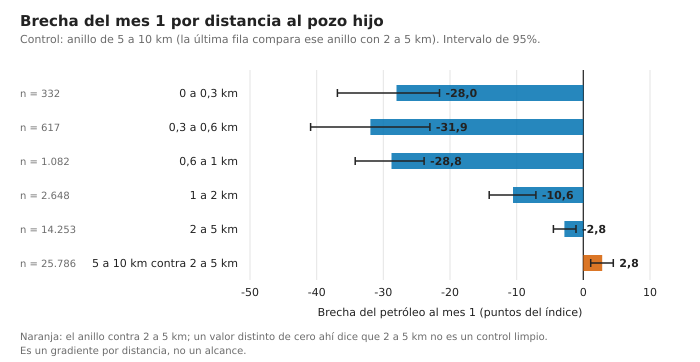

# Interferencia entre pozos en Vaca Muerta con datos públicos

> **Abstract (English).** Question: when a new well is fracked, do neighbouring producing wells yield less than similar wells farther away?
> Data: public monthly production per well and frac data from Argentina's energy secretariat; no trajectories, daily production or declared shut-ins.
> Method: an event study of 2,094 events, near parents against same-age controls, with placebo, permutation and out-of-time tests.
> Result: one month after the frac the near parents yield 19 to 23 percentage points less (23 is a raw upper bound, 19 is net of the pre-trend); the deferral of months 0 to 6 ranges from 6.4 to 11.4 million barrels.
> Limits: a measured footprint, not a demonstrated cause; there is a gap before the frac, the control is not a clean zero, and the effect is real on average but noisy per event.

## 1. La pregunta

Cuando se fractura un pozo nuevo, ¿los pozos vecinos que ya producían rinden menos que pozos parecidos más lejos? Acá se responde solo con datos abiertos, y se dice qué se puede afirmar con ellos y qué no. Lo que sale es una huella medida contra un control, no una causa.

## 2. Los datos y lo que no se mide

| Dato | Fuente y cobertura | Qué no se observa |
| --- | --- | --- |
| Producción | datos abiertos de la Secretaría de Energía: 436.308 filas de producción mensual por pozo no convencional | producción diaria; cierres declarados (un cierre preventivo se ve igual que un daño) |
| Fractura y ubicación | fecha de cada fractura y coordenadas de superficie del pad | trayectoria de la rama y espaciamiento real |
| Causas | ninguna | por qué cambió el caudal de un pozo |

## 3. El método en seis líneas

1. Un evento es la fractura de un pozo nuevo (el hijo). Los padres son pozos que ya producían a menos de 1 km del hijo; los controles son pozos de la misma edad a 2 a 5 km del mismo hijo.
2. Cada pozo se mide contra su propio caudal previo, así que se comparan niveles relativos y no volúmenes.
3. La brecha es la mediana del índice de los padres menos la de los controles, mes a mes (k = 0 es el mes de la fractura): un estudio de eventos con 2.094 eventos.
4. Los intervalos de 95% son bootstrap por pads hijo, para no tratar como independientes a pozos que comparten una fractura; el de la brecha del mes 1 es además bootstrap por bloques espaciales de 5 km (sección 4), que es el que se informa.
5. Se mira la pretendencia (los meses previos) y se corren pruebas de falsificación (sección 5).
6. Pruebas corridas: 17 hipótesis con umbral fijo (seis más dos de bloques espaciales, cinco de validación por inyección, dos de replicación en otra cuenca, una del lado del hijo y una del perfil por año), escrito de antemano en un libro versionado, y 13 subconjuntos de robustez que se publican aunque debiliten el resultado; la descomposición agrega 141 intervalos sin ajuste por comparaciones múltiples, así que alguno puede quedar fuera de cero por azar. En total son 193 pruebas estadísticas: 17 hipótesis, 13 subconjuntos de robustez, 141 intervalos de la descomposición, 9 intervalos descriptivos del lado del hijo y 13 intervalos por bloques que no son hipótesis.

Prueba del método con efectos plantados (`wiki/hallazgos/inyeccion.md`): sobre datos reales con fechas falsas, una caída plantada de 20% del caudal (unos -17,4 puntos del índice) se recupera como -19,5 puntos, que suma esa caída y la brecha residual del mundo nulo (-2,2); descontado el nulo, el estimador devuelve -17,3 puntos; se cumplen 5 de las 5 reglas fijadas de antemano. La de falsos positivos da 2 de 30 mundos (7%), bajo el máximo fijado; con la versión anterior de los datos esa misma regla estaba en el borde exacto.

## 4. El resultado

Un mes después de la fractura, los padres a menos de 1 km rinden entre 19 y 23 puntos menos que los controles de la misma edad. El 23 es el valor en bruto y una cota superior (-23,0 puntos con la base de los meses -3 a -1); el 19 descuenta la brecha previa a la fractura (el 20 es el mismo descuento sin los golpes previos de vecinos). El IC 95% por bloques espaciales de 5 km (145 bloques) de la brecha de 23,0 va de -30,0 a -17,0 puntos (por pads era -27,3 a -18,2); no cruza -10 y el rango de 19 a 23 se mantiene.

**Pretendencia.** Antes de la fractura ya hay una brecha: -2,5, -3,6 y -6,3 puntos en los meses -3, -2 y -1, con la base de los meses -6 a -4 (línea naranja de la figura). Con datos mensuales no se separa un nivel distinto de los padres cercanos de un efecto anticipado; por eso 23 es una cota superior y no el valor.

**Cierre.** A los 6 meses la brecha casi se cierra: -2,1 puntos en el mes 6. El diferido de los meses 0 a 6 va de 6,4 a 11,4 millones de barriles, medido contra el control de la misma edad. El extremo alto suma cada evento por separado; el bajo cuenta cada mes de un padre una sola vez y descuenta la brecha previa hasta el total original. No se da un punto medio: el rango dice cuánto depende la cifra de cómo se cuente. Es diferido contra un control, sin precio y sin causa atribuida. Por evento, a 24 meses, la mediana es -954 barriles y su intervalo de 95% incluye el cero: el padre típico no acumula diferido contra su control en esa ventana.

**Qué parte son días y qué parte caudal.** Al mes 1 la lectura es mixta (panel inferior de la figura): los días producidos explican el 52% de la brecha del volumen y el caudal por día el 48%. Sin los meses cerrados enteros sigue mixta (42% y 58%). El 45% de los padres cercanos redujo sus días producidos en más de una décima, contra el 20% de los controles.

**Distancia.** Contra un anillo de 5 a 10 km (con la base de los meses -6 a -4), la brecha del mes 1 va de -28,1 a -32,1 puntos en las tres bandas de menos de 1 km, es -10,8 de 1 a 2 km y -2,9 de 2 a 5 km. Cambia de forma gradual: es un gradiente por distancia, no un alcance. Los padres del anillo de 5 a 10 km rinden 2,9 puntos más que los de 2 a 5 km, así que el control habitual no es un cero limpio: contra el anillo la brecha del mes 1 es -24,6 puntos, más negativa que los -23,0 contra 2 a 5 km. Si ese control está también afectado, el diferido medido contra él queda corto.

**Por año.** La barra de 2026 (44 puntos menos, año en curso) no se lee como suba: a los últimos años les faltan fracturas por cargar. Con igual antigüedad de carga en todos los años, 2026 menos 2021 a 2024 da -15,1 puntos (IC 95% por bloques de 5 km: -43,5 a 10,9): no firme, con regla fijada de antemano (`wiki/hallazgos/carga_anual.md`).

## 5. Lo que dijeron las pruebas de falsificación

- **Fechas falsas.** Corriendo la fecha de fractura medio año y un año, antes y después, la brecha del mes 1 va de -2,4 a 0,5 puntos y todos los intervalos incluyen el cero. Solo los corrimientos hacia atrás son placebos limpios.
- **Permutación.** Con 200 permutaciones de las fechas entre hijos del mismo año, la brecha va de -8,1 a -4,9 puntos (media -6,4), contra -23,0 la real. La media no es cero: una lectura posible es que un padre cercano a un hijo lo esté también de otro que sí fracturó en esa fecha (no se verificó), y por eso el valor p es un piso y no una probabilidad exacta.
- **Eje fuera de tiempo.** El eje de mayor merma estimado con los eventos viejos da 92 grados y con los nuevos 89. El eje viejo no predice mejor los eventos nuevos que el SHmax publicado ni que un eje al azar.

Pasar estas pruebas descarta una brecha que aparezca en cualquier fecha; no demuestra causalidad ni separa un daño de un cierre preventivo del operador.

## 6. Lo que no funcionó y por qué informa

- **El eje este-oeste no es hallazgo.** El eje de merma de la cuenca es de 93 grados (IC de 70 a 123) y no se separa del SHmax publicado, de 67,5 grados; la regla de parada se cumplió (`wiki/hallazgos/eje_parada.md`).
- **El modelo de costo no predice un evento.** Fuera de muestra su R2 es -0,18 contra -0,03 de predecir la media del área, y solo el coeficiente de la distancia excluye cero, y por poco. Sirve para describir la huella, no para anticipar un pozo.
- **El lado del hijo no se puede leer.** Un hijo con más de 434 bbl por metro de rama de petróleo ya producido a menos de 1 km difiere de uno en zona virgen en -0,2 bbl por metro a 12 meses (IC 95%: -12,6 a 12,2; la mediana virgen es de 84,2), pero el control negativo, con pozos posteriores del hijo, da 8,9 (IC 2,1 a 15,7). Resultado: no firme.
- **Agrupar hijos en un mes:** no se puede leer (`wiki/hallazgos/golpes_mismo_mes.md`).
- **En otra cuenca.**

| Colorado (cuenca DJ) | Brecha (puntos) | IC 95% por bloques de 5 km |
| --- | ---: | --- |
| Mes 1, por día calendario (la medida de la regla): se replica | -19,9 | -27,5 a -14,8 |
| Mes -1 previo, base limpia | -6,9 | -10,2 a -4,2 |
| Mes 1, por día producido: cerca de 60% menos, con menos eventos | -8,1 | -11,3 a -5,2 |

## 7. Qué cambiaría la conclusión

- **Trayectorias de la rama** (`wiki/hallazgos/trayectorias.md`): darían el espaciamiento real y convertirían el gradiente por distancia en un alcance medido.
- **Producción diaria:** separaría un cierre de un golpe dentro del mes y resolvería la lectura mixta de días y caudal.
- **Cierres declarados por las operadoras:** permitirían descartar los cierres preventivos.
- **La brecha previa:** si se pudiera distinguir un nivel de un efecto anticipado, el rango entre el valor en bruto y el descontado se reduciría a un solo número.

## 8. Cómo verificarlo

- `uv run python -m pipeline.run_all` reconstruye todo.
- `uv run python -m pipeline.claims` verifica contra el warehouse cada cifra de esta página y devuelve un código de salida distinto de cero si alguna cambia.
- `docs/verificacion.md` lista las cinco preguntas que plantea el estudio y cómo se verifica cada una.
